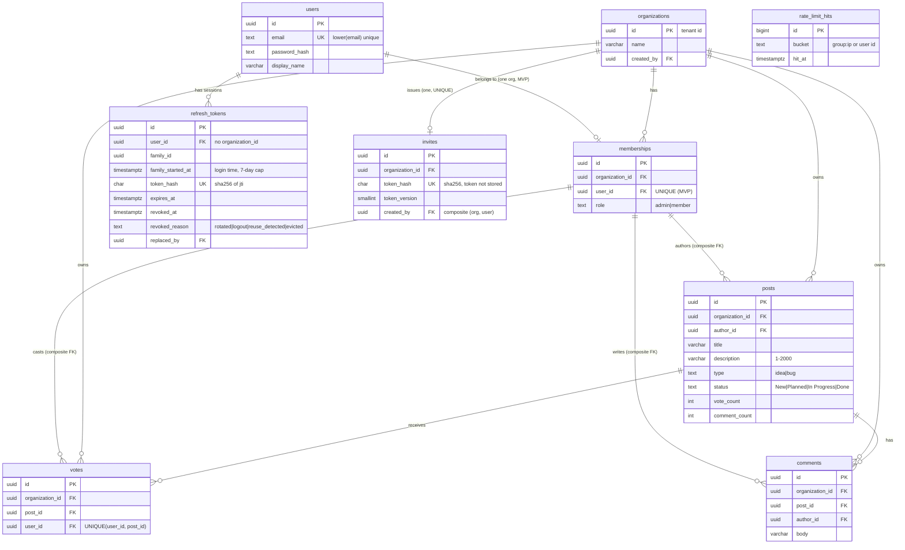

# Data model: Team Feedback Board

Status: Proposed (awaiting Orchestrator approval) | Owner: architect-bot | Task: TASK-001 | Date: 2026-10-27
Database: PostgreSQL 18 (docs/project/stack.md). Migrations: Alembic. ORM: SQLAlchemy 2.1.
Sources: brief.md features F1-F9 and ASSUMED list. Stories F1-F9 and E2E-1 exist on main (TASK-002, PR #3 version, commit `b495550`); where a story states a limit or rule, this model follows the story, and where it only says ASSUMED the number is repeated here as ASSUMED.

## 1. Tenancy strategy
- **Model: shared tables with `organization_id` (row-level tenancy).** One database, one schema. Chosen because the product is free, small, single-region, and needs `docker compose up` simplicity; schema-per-tenant or DB-per-tenant would add migration and ops cost with no benefit at this scale.
- **Tenant = organization.** `organizations.id` is the tenant id. A user belongs to exactly one organization in the MVP (ASSUMED in brief).
- **Every tenant-owned table carries `organization_id uuid NOT NULL`, indexed:** `memberships`, `invites`, `posts`, `votes`, `comments`. `organizations` is the tenant root (its `id` is the tenant id). **Two technical tables are deliberately not tenant-owned and carry no `organization_id`: `refresh_tokens` (a login session belongs to a user, who exists before any organization; the `org` claim is re-read from `memberships` at every refresh, so no tenant id is ever stored in or trusted from a refresh token) and `rate_limit_hits` (keyed by IP or user id, holds no tenant data).** Neither is reachable through any tenant endpoint. **`users` is deliberately global** (a login identity that exists before it has an organization; email must be unique across the system); it is linked to a tenant only through `memberships`, and it is never returned to another organization except the minimal author fields (`id`, `display_name`) on posts and comments of the viewer's own org.
- **How isolation is enforced (defence in depth):**
  1. *Token:* the tenant id comes only from the verified JWT `org` claim (ADR-002), never from a request field.
  2. *Application:* a request-scoped `TenantContext(organization_id, user_id, role)` is the only way to obtain a repository/DB session for tenant tables; every repository method takes `organization_id` and includes `WHERE organization_id = :org` in every SELECT, UPDATE and DELETE. Lookups by id are `WHERE id = :id AND organization_id = :org`; not found (including "exists in another org") returns 404.
  3. *Database:* composite foreign keys make cross-org links impossible: `votes (organization_id, post_id)` and `comments (organization_id, post_id)` reference `posts (organization_id, id)`, and the user columns `posts (organization_id, author_id)`, `comments (organization_id, author_id)`, `votes (organization_id, user_id)` and `invites (organization_id, created_by)` reference `memberships (organization_id, user_id)` (security review note 9, adopted in attempt 2b). A vote or comment therefore cannot point at a post of another org, and an author or voter must be a member of that org, even through a bug. The `org` claim is trusted only after the membership row `(sub, org)` was found (ADR-002), so a stale claim gives 401.
  4. *Tests (required, qa-bot):* for every tenant endpoint, a test with two organizations proving org B cannot read, list, vote, comment on, change or delete org A's rows (expect 404 / empty list).
  5. *Database role (required, ADR-004):* the application connects with a **non-owner, non-superuser role** that has only SELECT/INSERT/UPDATE/DELETE on the tables (no DDL, no `BYPASSRLS`); Alembic runs with a separate owner role. This is the prerequisite for RLS.
  6. *Follow-up (not MVP, scheduled):* PostgreSQL Row-Level Security with `SET LOCAL app.organization_id` on the tenant tables as a second line of defence (section 8).
- **Membership uniqueness:** `UNIQUE (user_id)` on `memberships` enforces one org per user for the MVP. When multiple orgs per user arrives (post-MVP), drop that constraint and make the JWT `org` claim a selection (migration impact in section 7).

## 2. Conventions
- IDs: `uuid`, default `uuidv7()` (native in PostgreSQL 18; time-ordered, index-friendly). IDs are exposed as strings in the API.
- Timestamps: `timestamptz NOT NULL DEFAULT now()` (`created_at`, `updated_at`; `updated_at` maintained by the ORM on update). All stored and returned in UTC.
- Enums are `text` with `CHECK` constraints (easier Alembic changes than native enums).
- Names are `snake_case`, tables plural. Deletion of posts is a **hard delete** (F9) and cascades to its votes and comments; no soft delete in the MVP.
- Emails are stored lower-cased by the application and protected by a unique index on `lower(email)`.

## 3. Entities

### 3.1 users (global identity, not tenant-owned)
| Column | Type | Null | Default | Constraints / validation | Notes |
|---|---|---|---|---|---|
| id | uuid | no | uuidv7() | PK | |
| email | text | no | | unique via `CREATE UNIQUE INDEX users_email_lower_key ON users (lower(email))` (an expression cannot be a table-level UNIQUE constraint in PostgreSQL); length 3-254; valid email format | **PII** |
| password_hash | text | no | | Argon2id encoded string (ADR-002) | **Secret**, never returned or logged |
| display_name | varchar(80) | no | | **trim leading/trailing whitespace first, then validate length 1-80; the trimmed value is stored** | **PII** |
| created_at | timestamptz | no | now() | | |
| updated_at | timestamptz | no | now() | | |

### 3.2 organizations (tenant root)
| Column | Type | Null | Default | Constraints / validation | Notes |
|---|---|---|---|---|---|
| id | uuid | no | uuidv7() | PK | this is the tenant id |
| name | varchar(60) | no | | length 1-60 after trim (story F2-1); duplicates allowed | |
| created_by | uuid | no | | FK users(id) ON DELETE NO ACTION | audit (cannot be a membership FK: the creator's membership is inserted after the organization) |
| created_at | timestamptz | no | now() | | |
| updated_at | timestamptz | no | now() | | |

### 3.3 memberships (user <-> organization, with role)
| Column | Type | Null | Default | Constraints / validation | Notes |
|---|---|---|---|---|---|
| id | uuid | no | uuidv7() | PK | |
| organization_id | uuid | no | | FK organizations(id) ON DELETE CASCADE | tenant column |
| user_id | uuid | no | | FK users(id) ON DELETE CASCADE; **UNIQUE (user_id)** | one org per user (MVP) |
| role | text | no | | CHECK role IN ('admin','member') | creator of an org = admin; invite acceptors = member |
| created_at | timestamptz | no | now() | | |
| updated_at | timestamptz | no | now() | | |
Also: `UNIQUE (organization_id, user_id)` (kept for the post-MVP multi-org change).

### 3.4 invites (exactly one persistent invite token per organization; story F3-1)
| Column | Type | Null | Default | Constraints / validation | Notes |
|---|---|---|---|---|---|
| id | uuid | no | uuidv7() | PK | |
| organization_id | uuid | no | | FK organizations(id) ON DELETE CASCADE; **UNIQUE** | tenant column; UNIQUE = one invite token per organization |
| token_hash | char(64) | no | | **UNIQUE**; CHECK token_hash ~ '^[0-9a-f]{64}$' | hex SHA-256 of the invite token. **The token itself is not stored**: it is derived (ADR-003) as `base64url(HMAC-SHA256(key, 'invite:v' \|\| token_version \|\| ':' \|\| organization_id))` where `key` is the **raw bytes decoded from `INVITE_TOKEN_KEY`** (at least 32 bytes, not the text), 43 characters, so an admin is shown the same link every time (F3-1) while a database leak or backup does not reveal usable links |
| token_version | smallint | no | 1 | CHECK token_version >= 1 | input of the derivation; bumping it would later allow "regenerate link" without a schema change (not exposed in the MVP) |
| created_by | uuid | no | | composite FK `(organization_id, created_by)` -> memberships(organization_id, user_id) ON DELETE NO ACTION | audit; must be an admin of the org (checked by the application) |
| created_at | timestamptz | no | now() | | |
| updated_at | timestamptz | no | now() | | |
Accepting an invite does not consume it (reusable). **There is no expiry, no revoke/regenerate endpoint and no remove-member endpoint in the MVP (product scope, F3-1); this is a documented risk and follow-up (section 8, ADR-003).** Creation is get-or-create: `INSERT ... ON CONFLICT (organization_id) DO NOTHING` then `SELECT`, so two admins clicking at once still yield one row; the token is then derived from the row's `organization_id` and `token_version`. Lookup is by `token_hash = sha256(token from the POST body)` (public endpoints, so it is the one lookup without a tenant filter; it resolves the tenant and reads only the organization name), followed by a constant-time check that the submitted token equals the token re-derived from the row's `organization_id` and `token_version` with the *current* `INVITE_TOKEN_KEY`. The comparison is on the hash of a 256-bit value, so timing is not a practical oracle.
**Key rotation (attempt 3, ADR-003; security-bot to confirm):** `POST /organizations/current/invite` locks the row (`SELECT ... FOR UPDATE`), re-derives the token with the current key and, if `sha256(token) <> token_hash`, runs `UPDATE invites SET token_hash = :new, updated_at = now() WHERE organization_id = :org` in the same transaction; `token_version` is unchanged by a key rotation (it changes only for a future "regenerate link"). The extra check on lookup makes old links fail at once after a rotation; the new link works once an admin has opened "Invite". HMAC input is `'invite:v' || token_version (decimal ASCII) || ':' || organization_id (canonical lowercase hyphenated UUID text, 36 characters)`; ADR-003 has a test vector.

### 3.5 posts
| Column | Type | Null | Default | Constraints / validation | Notes |
|---|---|---|---|---|---|
| id | uuid | no | uuidv7() | PK | |
| organization_id | uuid | no | | FK organizations(id) ON DELETE CASCADE | tenant column |
| author_id | uuid | no | | composite FK `(organization_id, author_id)` -> memberships(organization_id, user_id) ON DELETE NO ACTION | audit; author must be a member of the post's organization |
| title | varchar(120) | no | | length 1-120 after trim (story F4-1) | |
| description | varchar(2000) | no | | length 1-2000 after trim (story F4-1: required) | |
| type | text | no | | CHECK type IN ('idea','bug') | |
| status | text | no | 'New' | CHECK status IN ('New','Planned','In Progress','Done') | admin may set any value in any direction (ASSUMED) |
| vote_count | integer | no | 0 | CHECK vote_count >= 0 | denormalised count of `votes` rows; changed only in the same transaction that inserts/deletes a vote |
| comment_count | integer | no | 0 | CHECK comment_count >= 0 | denormalised, same rule for comments |
| created_at | timestamptz | no | now() | | |
| updated_at | timestamptz | no | now() | | bumped on status change |
Also: `UNIQUE (organization_id, id)` (target of composite foreign keys).

### 3.6 votes (one upvote per user per post)
| Column | Type | Null | Default | Constraints / validation | Notes |
|---|---|---|---|---|---|
| id | uuid | no | uuidv7() | PK | |
| organization_id | uuid | no | | part of composite FK | tenant column |
| post_id | uuid | no | | composite FK `(organization_id, post_id)` -> posts(organization_id, id) ON DELETE CASCADE | |
| user_id | uuid | no | | composite FK `(organization_id, user_id)` -> memberships(organization_id, user_id) ON DELETE NO ACTION | voter must be a member of the organization |
| created_at | timestamptz | no | now() | | |
| updated_at | timestamptz | no | now() | | rows are immutable; column kept for the standard-columns rule |
Constraint: **`UNIQUE (user_id, post_id)`** (acceptance criterion).
**Vote toggle** (single endpoint `POST /posts/{post_id}/vote`, story F5-1), one transaction, all statements filtered by the caller's `organization_id`:
1. `DELETE FROM votes WHERE user_id = :u AND post_id = :p AND organization_id = :org RETURNING id`. If a row came back: `UPDATE posts SET vote_count = vote_count - 1 WHERE id = :p AND organization_id = :org`; result `has_voted = false`.
2. Otherwise `INSERT INTO votes (organization_id, post_id, user_id) VALUES (...) ON CONFLICT (user_id, post_id) DO NOTHING RETURNING id`. If a row came back: `UPDATE posts SET vote_count = vote_count + 1 ...`; result `has_voted = true`.
3. If the insert returned nothing, a concurrent request of the same user inserted first: do not change anything and return the current state (re-read `vote_count` and `has_voted`). The user can never end up with two votes, and no request fails with 500.
`vote_count` is changed only by the `UPDATE ... SET vote_count = vote_count +/- 1` statements above (atomic in SQL, never read-modify-write in Python); `CHECK (vote_count >= 0)` on `posts`. The post must exist in the caller's organization first (`SELECT ... WHERE id = :p AND organization_id = :org`), otherwise 404 and nothing is written.

### 3.7 comments
| Column | Type | Null | Default | Constraints / validation | Notes |
|---|---|---|---|---|---|
| id | uuid | no | uuidv7() | PK | |
| organization_id | uuid | no | | part of composite FK | tenant column |
| post_id | uuid | no | | composite FK `(organization_id, post_id)` -> posts(organization_id, id) ON DELETE CASCADE | |
| author_id | uuid | no | | composite FK `(organization_id, author_id)` -> memberships(organization_id, user_id) ON DELETE NO ACTION | audit; author must be a member of the post's organization |
| body | varchar(1000) | no | | length 1-1000 after trim (story F6-1) | |
| created_at | timestamptz | no | now() | | |
| updated_at | timestamptz | no | now() | | members cannot edit comments (not in MVP) |

### 3.8 refresh_tokens (server-side refresh-token families; ADR-002, not tenant-owned)
One row per issued refresh token. A **family** is one login session: all tokens created by rotation from one login share `family_id` and `family_started_at`. The cookie holds a JWT (`typ=refresh`) whose `jti` is a random 256-bit value; **only `sha256(jti)` is stored**, so a database leak does not yield usable tokens. **This table supersedes the Attempt 2 note "refresh tokens are stateless, no revocation in the MVP"** (security review blocker 1).
| Column | Type | Null | Default | Constraints / validation | Notes |
|---|---|---|---|---|---|
| id | uuid | no | uuidv7() | PK | |
| user_id | uuid | no | | FK users(id) ON DELETE CASCADE | the identity; **no `organization_id`**, see section 1 |
| family_id | uuid | no | | | same for every token of one login session (value = `id` of the first token) |
| family_started_at | timestamptz | no | now() | | login time, copied unchanged to every rotated token: the anchor of the **absolute 7-day cap** |
| token_hash | char(64) | no | | **UNIQUE**; CHECK token_hash ~ '^[0-9a-f]{64}$' | hex SHA-256 of the refresh JWT `jti` |
| expires_at | timestamptz | no | | CHECK expires_at <= family_started_at + interval '7 days' | always `family_started_at + 7 days`: rotation never extends the session |
| revoked_at | timestamptz | yes | | | set on rotation, logout, reuse detection or eviction by the 10-family cap |
| revoked_reason | text | yes | | CHECK revoked_reason IN ('rotated','logout','reuse_detected','evicted') | NULL while the token is active; set together with `revoked_at` (CHECK both-null-or-both-set) |
| replaced_by | uuid | yes | | FK refresh_tokens(id) ON DELETE SET NULL | the token issued by the rotation of this one |
| created_at | timestamptz | no | now() | | |
**Serialisation per family (attempt 3, security-bot N1; ADR-002):** a revoke cannot lock a successor row that a concurrent rotation has not committed yet, so every rotation, reuse revoke, logout and cap eviction first takes `pg_advisory_xact_lock(hashtextextended('rt_family:' || :family_id, 0))`, and login/signup first take `pg_advisory_xact_lock(hashtextextended('rt_user:' || :user_id, 0))` (order: user lock, then family lock; refresh and logout take only the family lock). The transaction runs at **READ COMMITTED** (required: after the lock is granted each statement must see what the previous holder committed). The row is found by `token_hash` without a lock only to learn `family_id`, then re-read `FOR UPDATE` after the lock. Cap eviction also takes the evicted family's lock; when a transaction needs several family locks they are taken in ascending `family_id` after the user lock; the password hash or verify runs before any lock is taken; every such transaction sets `lock_timeout = '5s'` (500 `INTERNAL_ERROR` on timeout); a future revoke-all takes the user lock and then all family locks in ascending order (security-bot A3-1, A3-2, A3-4, A3-5; ADR-002). Concurrency tests (with negative controls and `REFRESH_REUSE_LEEWAY_SECONDS=0` for the reuse test) are listed in ADR-002 (logout vs refresh, reuse vs refresh, 12 concurrent logins).
Algorithm (one transaction at READ COMMITTED, family lock taken first, then `SELECT ... FOR UPDATE` on the row found by `token_hash`):
1. Not found, or `expires_at <= now()` (exact, no JWT leeway): 401, clear cookie.
2. `revoked_at IS NOT NULL`: **reuse**. The presented row's `revoked_reason` decides. If it is `rotated` and `revoked_at` is **less than** `REFRESH_REUSE_LEEWAY_SECONDS` (default 10) ago, answer 401, **change nothing and send no `Set-Cookie`** (two tabs racing: the cookie that the winning tab just received must survive). If it is `rotated` and `revoked_at` is 10 s or more ago, `UPDATE refresh_tokens SET revoked_at = now(), revoked_reason = 'reuse_detected' WHERE family_id = :f AND revoked_at IS NULL` and answer 401 **and clear the cookie**. If it is any other reason (`logout`, `evicted`, `reuse_detected`) the leeway does **not** apply, whatever the age of `revoked_at`: it is reuse of a dead family, so run the same `UPDATE` (it finds no active row) and answer 401 **and clear the cookie**.
3. Active: insert the successor (same `user_id`, `family_id`, `family_started_at`, `expires_at = family_started_at + 7 days`), set the old row `revoked_at = now(), revoked_reason = 'rotated', replaced_by = :new`, load the user's membership (`org`, `role`) and return a new access token.
**Cookie on a 401 from `/auth/refresh` (attempt 5):** **Refresh 401 cookie rule (one rule; the same case list is in ADR-002, ADR-004, data-model 3.8 and the contract):** a 401 from `/auth/refresh` sends **no `Set-Cookie` in exactly one case**: the presented token's own row has `revoked_reason = 'rotated'` and `revoked_at` is **less than** `REFRESH_REUSE_LEEWAY_SECONDS` (default 10) ago; nothing is changed (two tabs racing, the winning tab's new cookie must survive). **Every other 401 clears the cookie** (`Set-Cookie: refresh_token=; Max-Age=0`): (a) the cookie is missing, or its JWT is invalid, has the wrong `typ` or is expired; (b) there is no row for the token, or its `expires_at` has passed (the 7-day cap included); (c) `revoked_reason = 'rotated'` and `revoked_at` is 10 s or more ago: reuse, every active row of the family is revoked with `reuse_detected` (none if the family is already dead); (d) any other `revoked_reason` (`logout`, `evicted`, `reuse_detected`), **at any time, including within 10 s of `revoked_at`**: the leeway does not apply to it, so it is treated as reuse of a dead family and the answer is 401 with the cookie cleared (the family is already revoked, nothing else changes). The leeway covers **only tokens revoked with reason `rotated`**, and only within 10 s of that `revoked_at`; a token revoked by logout, eviction or reuse detection is never inside it. The rule looks only at the presented row: a token that was rotated 3 s ago and whose family was then logged out or evicted is still `rotated`, so it gets the no-cookie 401 (the family is already dead; logout cleared the cookie in that browser). Tests: ADR-002 (leeway tests).
Login and signup create a new family (`family_id` = the new `id`); if the request carries a `refresh_token` cookie whose JWT verifies (`typ=refresh`), the transaction first revokes that presented family (under the user lock, then its family lock; `revoked_reason = 'logout'`) so that logging in again in the same browser does not stack sessions (security-bot N4; no CSRF guard is needed because this only ends a session). **Logout** (under the family lock) sets `revoked_at = now(), revoked_reason = 'logout'` on every active row of the family, including a successor committed by a refresh that was in flight. At most **10 active families per user** (ASSUMED): creating the 11th (in the login transaction, under the user lock) revokes the active family with the lowest `family_started_at` (ties: lowest `family_id`; an active family has at least one row that is neither revoked nor expired; every active row of it gets `revoked_reason = 'evicted'`); that session gets 401 on its next refresh and has to log in again (the contract says so on signup and login). Cleanup: rows with `expires_at < now() - interval '30 days'` are deleted opportunistically at login (a scheduled job is a follow-up).

### 3.9 rate_limit_hits (shared rolling-window hit log; ADR-002, not tenant-owned)
The approved rule (brief, F1-2, F3-1) is **10 requests per rolling 60 seconds per IP per endpoint**, so the table logs hits and counts those inside the window; a fixed-window counter would allow up to twice the limit around a window boundary and would not give the "after Retry-After seconds a request succeeds" behaviour of F1-2 criterion 5 exactly. Rows live in PostgreSQL so that **all backend workers and containers share them** (an in-process limiter would multiply every limit by the number of workers). The table is `UNLOGGED` (no WAL; the limits simply reset after a database crash, which is acceptable).
| Column | Type | Null | Default | Constraints / validation | Notes |
|---|---|---|---|---|---|
| id | bigint | no | identity | PK (`GENERATED ALWAYS AS IDENTITY`) | tooling and deletes only |
| bucket | text | no | | length <= 200 | `<group>:<subject>`, for example `signup_ip:203.0.113.7`, `login_ip:...`, `refresh_ip:...`, `invite_preview_ip:...`, `invite_accept_ip:...`, `org_create_user:<user id>`. IPv4 is the full address, **IPv6 is the /64 prefix** (for example `2001:db8:1:2::/64`). Emails and tokens are never stored |
| hit_at | timestamptz | no | clock_timestamp() | | when an allowed request was counted |
Bucket keys: the client IP (with the endpoint group) for signup, login, refresh, invite preview and invite accept; the authenticated user id for organization create, which is checked after 415 and 401 so an unauthenticated request never creates a bucket (ADR-004 section 3, Attempt 9, ASSUMED). Algorithm (one short transaction): `SELECT pg_advisory_xact_lock(hashtextextended(:bucket, 0))`; `SELECT count(*), min(hit_at) FROM rate_limit_hits WHERE bucket = :bucket AND hit_at > clock_timestamp() - make_interval(secs => :window)`; if `count >= :max` answer 429 with `Retry-After = max(1, ceil(extract(epoch FROM min_hit_at + window - now)))` and **insert nothing**; otherwise `INSERT (bucket, hit_at)` and let the request proceed. Rejected requests are not stored, so a client that keeps retrying cannot extend its own block. The request counts whether or not it later succeeds. A bucket never holds more than `max` rows inside the window, so the count is cheap. Cleanup: each allowed hit deletes that bucket's rows older than the window (same transaction), and a background task (startup and every 60 s) deletes rows with `hit_at < now() - interval '1 hour'` so buckets of clients that never return disappear. The lock key is `hashtextextended(:bucket, 0)` (64-bit); the count and insert use their own short transaction, not the request's. Thresholds (default `10/60`), env vars and the proxy-trust assumption: ADR-002.

## 4. ER diagram

## 5. Indexes
Every foreign key and every query in brief F1-F9 is covered. PostgreSQL does not index FK columns automatically, so they are listed explicitly.

| Table | Index | Serves |
|---|---|---|
| users | UNIQUE INDEX (lower(email)) | login lookup, signup uniqueness (F1) |
| organizations | PK (id); (created_by) | FK |
| memberships | UNIQUE (user_id); UNIQUE (organization_id, user_id); (organization_id) | resolve user's org and role on each request; FK |
| invites | UNIQUE (token_hash); UNIQUE (organization_id); (organization_id, created_by) | preview/accept by token hash (F2, F3); FK |
| posts | UNIQUE (organization_id, id); (organization_id, vote_count DESC, created_at DESC, id DESC); (organization_id, type, vote_count DESC, created_at DESC, id DESC); (organization_id, status, vote_count DESC, created_at DESC, id DESC); (organization_id, author_id) | board sorted by votes (F7) and filtered by type and/or status: ordered by vote_count DESC, created_at DESC, id DESC; no pagination in the MVP (F7-1), so an index-ordered scan of one organization; FK |
| votes | UNIQUE (user_id, post_id); (organization_id, post_id); (organization_id, user_id) | one vote per user per post (F5); "has voted" for a page of posts; FK |
| comments | (organization_id, post_id, created_at, id); (organization_id, author_id) | comment list per post oldest first (F6); FK |
| refresh_tokens | PK (id); UNIQUE (token_hash); (family_id); (user_id, revoked_at); (expires_at) | lookup on refresh, revoke a whole family on reuse/logout, count active families per user, cleanup |
| rate_limit_hits | PK (id); (bucket, hit_at) | count hits of a bucket inside the window, min(hit_at) for Retry-After, cleanup by hit_at |

Filter combining both type and status uses the status index and filters type in memory; at MVP scale this is fine. Revisit with `EXPLAIN` if lists exceed ~10k posts per organization.

## 6. Sensitive data handling
| Field | Class | Protection |
|---|---|---|
| users.password_hash | secret | Argon2id (ADR-002); never selected into API models; never logged |
| users.email | PII | unique, lower-cased; returned only to the owner (`/auth/me`) and, in invite/comment/post author objects, **not** returned (only `id` + `display_name`); not logged in clear in error logs |
| users.display_name | PII (low) | shown to members of the same organization only |
| invites.token_hash | secret-derived | only the SHA-256 of the invite token is stored; the token is re-derived with `INVITE_TOKEN_KEY` when an admin asks for the link. The token is returned only to admins of that org (`POST /organizations/current/invite`) and is accepted only **in a POST body** (`POST /invites/preview`, `POST /invites/accept`); the link uses the URL fragment (`/join#<token>`), so it is never in a server-visible path or query, in access logs or in `Referer` (ADR-003). Bodies of `/invites/*` and `/auth/*` are not logged; invite responses are `Cache-Control: no-store`; the token is never written to application logs by value |
| refresh_tokens.token_hash | secret-derived | SHA-256 of the refresh `jti`; the refresh JWT is only in the HttpOnly cookie; rows are revoked, never edited otherwise (ADR-002) |
| rate_limit_hits.bucket | PII-derived | contains an IP address (IPv6 as /64) or a user id; emails are never stored; rows are deleted after an hour |
| JWT secret, invite token key | secret | env vars `JWT_SECRET` and `INVITE_TOKEN_KEY` (each must decode to at least 32 bytes, ADR-002), never in the database or repo |
| Payment data | n/a | none: free product, no billing |
Backups and logs must not contain raw tokens or passwords. Structured logs record admin actions (status change, delete: actor id, organization id, post id, timestamp) for auditability; a persistent audit table is a follow-up (section 8).

## 7. Migration and compatibility notes
- Initial schema = one Alembic revision `0001_initial` creating all **nine** tables (the seven business tables plus `refresh_tokens` and `rate_limit_hits`; `rate_limit_hits` is created `UNLOGGED`), constraints and indexes above (backend-bot, not architect-bot).
- Planned change "multiple organizations per user" (post-MVP): drop `UNIQUE (user_id)` on `memberships`; JWT `org` becomes the selected org; no data migration needed. Needs an ADR and a contract version bump.
- Revocable / regenerable / expiring invite (out of MVP per F3-1): `invites.token_version` already allows regeneration (bump the version); an expiry or revoke needs a new column and an endpoint; needs an ADR.
- Removing a member (out of MVP): the composite FKs to `memberships` (on `posts`, `comments`, `votes`, `invites`) are `ON DELETE NO ACTION` (checked at the end of the statement, so deleting a whole organization, which cascades to its posts and memberships in one statement, would still work, whereas `RESTRICT` is immediate and depends on the cascade order; deleting an organization is itself out of the MVP), so removing a single member is rejected by the database and needs a design (anonymise or reassign content, delete the member's votes) and an ADR.
- Any change to this approved model needs an ADR and Orchestrator go-ahead (architect rules).

## 8. Open questions / follow-ups
- **Verification gate in three checkpoints (attempt 6; ADR-004 section 7, R7).** Nothing in this file has been run against PostgreSQL. **G1 at TASK-006:** the first Alembic migration (`0001_initial`) is applied on `postgres:18.6-alpine` (a real database, not a mock) and the DDL constraint tests pass (checks, composite FKs, `UNIQUE (user_id, post_id)`, `UNLOGGED` table, `ON DELETE NO ACTION`); TASK-006 is accepted on G1 only. **G2 at TASK-010:** the four per-family advisory-lock concurrency tests with their negative controls (unchanged; section 3.8, ADR-002), each also asserting that the lock and the `SELECT ... FOR UPDATE` re-read and the writes of the family run in one transaction on one connection (A3-3(e); the initial non-locking lookup is not part of this assertion), and the limiter tests for the endpoints that exist at TASK-010 (signup, login and refresh: exact 10-per-60 s window, 11th request 429 with `Retry-After >= 1`, IPv6 /64 bucketing, per-endpoint buckets across those three, the `RATE_LIMIT_ENABLED` guard fails closed in production, the 429 of refresh carries `Vary: Origin`). **Split by the task that can run each test (ASSUMED assignment, to confirm with the Orchestrator because `plan.md` still lists the invite preview limiter under TASK-010 although the preview endpoint is built in TASK-017):** the invite preview and accept limiter buckets are tested at TASK-017, and the nginx client-address test at TASK-007; neither is part of G2 pass on that database. **G3 at TASK-017:** the key-rotation tests (ADR-003) pass on that database. **R7 closes when G3 passes.** Owner: backend-bot writes, qa-bot verifies.
- Audit log table (who changed status or deleted what) is not in the brief; recommended as a later task.
- PostgreSQL RLS as defence in depth (section 1, point 5).
- Security follow-ups recorded after the security review (none is in a story): invite token expiry/regenerate/revoke and remove-member (product scope); RLS (section 1, point 6); a scheduled cleanup job for `refresh_tokens` and `rate_limit_hits`; JWT signing-key rotation with a `kid` header; a breached-password check and a longer minimum password length (F1-1 fixes the minimum at 8, NIST SP 800-63B-4 asks for 15 and ASVS 5.0.0 recommends 15, requires 8; a password blocklist, ASVS 6.2.4; ADR-004).
- Invite model follows story F3-1 (one persistent token per organization, shown again on every click); this replaces my first design (many hashed tokens, shown once). Attempt 2b keeps the one-link behaviour but stores only a hash and derives the token (ADR-003).
- Description is required (1-2000 characters) per story F4-1; limits for name/title/description/comment follow the stories, which are ASSUMED numbers there.

## Change log
- 2026-10-27: initial model for TASK-001 (architect-bot).
- 2026-10-27: attempt 2: header text and ER diagram corrected (stories exist, description varchar), email uniqueness as a unique index, vote toggle algorithm documented, invite-token log redaction (ADR-003).
- 2026-10-27: field limits aligned to TASK-002 stories (org name 60, title 120, description required 2000, comment 1000).
- 2026-10-27: invites changed to one persistent plain token per organization after TASK-002 story F3-1 landed (token_hash and revoked_at removed, UNIQUE (organization_id) added).
- 2026-10-27: attempt 2b (security review FAIL, PR #2): added `refresh_tokens` (rotation, reuse detection, absolute 7-day cap; **reverses** the stateless-refresh note) and `rate_limit_counters`; invites store `token_hash` + `token_version` instead of `token`; composite FKs to `memberships` on posts, comments, votes and invites; display_name trim-then-validate wording; non-owner DB role and RLS follow-up.
- 2026-10-27: attempt 3 (qa-bot review of attempt 2): `rate_limit_counters` (fixed window) replaced by `rate_limit_hits` (hit log, exact rolling window, default 10/60 per IP as in the brief and stories F1-2/F3-1, IPv6 by /64); the per-account `login_acct` bucket removed (per-account lockout is out of scope per F1-2 and is not offered); invite key rotation rule (admin endpoint updates `token_hash`, lookup re-checks against the current key); HMAC input pinned; `refresh_tokens.revoked_reason` gains `'evicted'` for the 10-family cap; composite FKs to `memberships` are `ON DELETE NO ACTION`; ER diagram shows one invite per organization.
- 2026-10-27: attempt 5 (qa-bot and security-bot reviews of attempt 4): verification gate for the unexecuted DDL added to section 8 (R7; split into G1-G3 in attempt 6); section 3.8 now states which 401 of `/auth/refresh` clears the cookie (all except a token revoked with reason `rotated` less than 10 s ago; a token revoked by logout or eviction is never inside the leeway); no table, column or constraint changed.
- 2026-10-27: attempt 6: the R7 gate is split into three checkpoints G1 (TASK-006), G2 (TASK-010) and G3 (TASK-017) in section 8; no table, column or constraint changed.
- 2026-10-27: attempt 7: checkpoint G2 in section 8 also covers the rate-limiter tests and the one-transaction assertion for the family locks; no table, column or constraint changed.
- 2026-10-27: attempt 8: checkpoint G2 in section 8 keeps the four advisory-lock tests, the one-transaction assertion (scoped to the locking re-read and the writes) and the limiter tests for signup, login and refresh; the invite limiter tests move to TASK-017 and the nginx client-address test to TASK-007 (ASSUMED assignment); no table, column or constraint changed.
- 2026-10-27: attempt 9: section 3.9 states that the organization-create bucket is keyed on the authenticated user id and checked after 415 and 401; no table, column or constraint changed.
