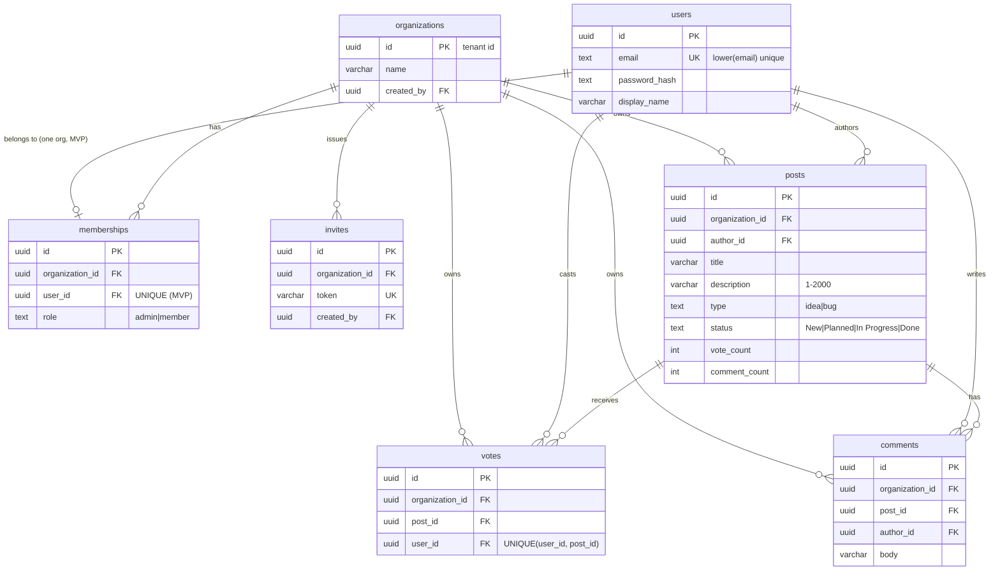

# Data model: Team Feedback Board

Status: Proposed (awaiting Orchestrator approval) | Owner: architect-bot | Task: TASK-001 | Date: 2026-10-27
Database: PostgreSQL 18 (docs/project/stack.md). Migrations: Alembic. ORM: SQLAlchemy 2.1.
Sources: brief.md features F1-F9 and ASSUMED list. Stories F1-F9 and E2E-1 exist on main (TASK-002, PR #3 version, commit `b495550`); where a story states a limit or rule, this model follows the story, and where it only says ASSUMED the number is repeated here as ASSUMED.

## 1. Tenancy strategy
- **Model: shared tables with `organization_id` (row-level tenancy).** One database, one schema. Chosen because the product is free, small, single-region, and needs `docker compose up` simplicity; schema-per-tenant or DB-per-tenant would add migration and ops cost with no benefit at this scale.
- **Tenant = organization.** `organizations.id` is the tenant id. A user belongs to exactly one organization in the MVP (ASSUMED in brief).
- **Every tenant-owned table carries `organization_id uuid NOT NULL`, indexed:** `memberships`, `invites`, `posts`, `votes`, `comments`. `organizations` is the tenant root (its `id` is the tenant id). **`users` is deliberately global** (a login identity that exists before it has an organization; email must be unique across the system); it is linked to a tenant only through `memberships`, and it is never returned to another organization except the minimal author fields (`id`, `display_name`) on posts and comments of the viewer's own org.
- **How isolation is enforced (defence in depth):**
  1. *Token:* the tenant id comes only from the verified JWT `org` claim (ADR-002), never from a request field.
  2. *Application:* a request-scoped `TenantContext(organization_id, user_id, role)` is the only way to obtain a repository/DB session for tenant tables; every repository method takes `organization_id` and includes `WHERE organization_id = :org` in every SELECT, UPDATE and DELETE. Lookups by id are `WHERE id = :id AND organization_id = :org`; not found (including "exists in another org") returns 404.
  3. *Database:* composite foreign keys make cross-org links impossible: `votes (organization_id, post_id)` and `comments (organization_id, post_id)` reference `posts (organization_id, id)`. A vote or comment therefore cannot point at a post of another org, even through a bug.
  4. *Tests (required, qa-bot):* for every tenant endpoint, a test with two organizations proving org B cannot read, list, vote, comment on, change or delete org A's rows (expect 404 / empty list).
  5. *Follow-up (not MVP):* PostgreSQL Row-Level Security with `SET LOCAL app.organization_id` and a non-owner DB role as a second line of defence.
- **Membership uniqueness:** `UNIQUE (user_id)` on `memberships` enforces one org per user for the MVP. When multiple orgs per user arrives (post-MVP), drop that constraint and make the JWT `org` claim a selection (migration impact in section 7).

## 2. Conventions
- IDs: `uuid`, default `uuidv7()` (native in PostgreSQL 18; time-ordered, index-friendly). IDs are exposed as strings in the API.
- Timestamps: `timestamptz NOT NULL DEFAULT now()` (`created_at`, `updated_at`; `updated_at` maintained by the ORM on update). All stored and returned in UTC.
- Enums are `text` with `CHECK` constraints (easier Alembic changes than native enums).
- Names are `snake_case`, tables plural. Deletion of posts is a **hard delete** (F9) and cascades to its votes and comments; no soft delete in the MVP.
- Emails are stored lower-cased by the application and protected by a unique index on `lower(email)`.

## 3. Entities

### 3.1 users (global identity, not tenant-owned)
| Column | Type | Null | Default | Constraints / validation | Notes |
|---|---|---|---|---|---|
| id | uuid | no | uuidv7() | PK | |
| email | text | no | | unique via `CREATE UNIQUE INDEX users_email_lower_key ON users (lower(email))` (an expression cannot be a table-level UNIQUE constraint in PostgreSQL); length 3-254; valid email format | **PII** |
| password_hash | text | no | | Argon2id encoded string (ADR-002) | **Secret**, never returned or logged |
| display_name | varchar(80) | no | | length 1-80 after trim | **PII** |
| created_at | timestamptz | no | now() | | |
| updated_at | timestamptz | no | now() | | |

### 3.2 organizations (tenant root)
| Column | Type | Null | Default | Constraints / validation | Notes |
|---|---|---|---|---|---|
| id | uuid | no | uuidv7() | PK | this is the tenant id |
| name | varchar(60) | no | | length 1-60 after trim (story F2-1); duplicates allowed | |
| created_by | uuid | no | | FK users(id) ON DELETE RESTRICT | audit |
| created_at | timestamptz | no | now() | | |
| updated_at | timestamptz | no | now() | | |

### 3.3 memberships (user <-> organization, with role)
| Column | Type | Null | Default | Constraints / validation | Notes |
|---|---|---|---|---|---|
| id | uuid | no | uuidv7() | PK | |
| organization_id | uuid | no | | FK organizations(id) ON DELETE CASCADE | tenant column |
| user_id | uuid | no | | FK users(id) ON DELETE CASCADE; **UNIQUE (user_id)** | one org per user (MVP) |
| role | text | no | | CHECK role IN ('admin','member') | creator of an org = admin; invite acceptors = member |
| created_at | timestamptz | no | now() | | |
| updated_at | timestamptz | no | now() | | |
Also: `UNIQUE (organization_id, user_id)` (kept for the post-MVP multi-org change).

### 3.4 invites (exactly one persistent invite token per organization; story F3-1)
| Column | Type | Null | Default | Constraints / validation | Notes |
|---|---|---|---|---|---|
| id | uuid | no | uuidv7() | PK | |
| organization_id | uuid | no | | FK organizations(id) ON DELETE CASCADE; **UNIQUE** | tenant column; UNIQUE = one invite token per organization |
| token | varchar(64) | no | | UNIQUE; CHECK length(token) >= 32 | **Secret**: 32 random bytes, URL-safe base64 (43 chars). Stored as-is (not hashed) because admins must be shown the same link on every click (F3-1) |
| created_by | uuid | no | | FK users(id) ON DELETE RESTRICT | audit; must be an admin of the org |
| created_at | timestamptz | no | now() | | |
| updated_at | timestamptz | no | now() | | |
Accepting an invite does not consume it (reusable; revocation is not in the MVP). Creation is get-or-create: `INSERT ... ON CONFLICT (organization_id) DO NOTHING` then `SELECT`, so two admins clicking at once still yield one token. Lookup is by `token` (public endpoint, so it is the one lookup without a tenant filter; it resolves the tenant, it does not read tenant data beyond the org name).

### 3.5 posts
| Column | Type | Null | Default | Constraints / validation | Notes |
|---|---|---|---|---|---|
| id | uuid | no | uuidv7() | PK | |
| organization_id | uuid | no | | FK organizations(id) ON DELETE CASCADE | tenant column |
| author_id | uuid | no | | FK users(id) ON DELETE RESTRICT | audit |
| title | varchar(120) | no | | length 1-120 after trim (story F4-1) | |
| description | varchar(2000) | no | | length 1-2000 after trim (story F4-1: required) | |
| type | text | no | | CHECK type IN ('idea','bug') | |
| status | text | no | 'New' | CHECK status IN ('New','Planned','In Progress','Done') | admin may set any value in any direction (ASSUMED) |
| vote_count | integer | no | 0 | CHECK vote_count >= 0 | denormalised count of `votes` rows; changed only in the same transaction that inserts/deletes a vote |
| comment_count | integer | no | 0 | CHECK comment_count >= 0 | denormalised, same rule for comments |
| created_at | timestamptz | no | now() | | |
| updated_at | timestamptz | no | now() | | bumped on status change |
Also: `UNIQUE (organization_id, id)` (target of composite foreign keys).

### 3.6 votes (one upvote per user per post)
| Column | Type | Null | Default | Constraints / validation | Notes |
|---|---|---|---|---|---|
| id | uuid | no | uuidv7() | PK | |
| organization_id | uuid | no | | part of composite FK | tenant column |
| post_id | uuid | no | | composite FK `(organization_id, post_id)` -> posts(organization_id, id) ON DELETE CASCADE | |
| user_id | uuid | no | | FK users(id) ON DELETE CASCADE | |
| created_at | timestamptz | no | now() | | |
| updated_at | timestamptz | no | now() | | rows are immutable; column kept for the standard-columns rule |
Constraint: **`UNIQUE (user_id, post_id)`** (acceptance criterion).
**Vote toggle** (single endpoint `POST /posts/{post_id}/vote`, story F5-1), one transaction, all statements filtered by the caller's `organization_id`:
1. `DELETE FROM votes WHERE user_id = :u AND post_id = :p AND organization_id = :org RETURNING id`. If a row came back: `UPDATE posts SET vote_count = vote_count - 1 WHERE id = :p AND organization_id = :org`; result `has_voted = false`.
2. Otherwise `INSERT INTO votes (organization_id, post_id, user_id) VALUES (...) ON CONFLICT (user_id, post_id) DO NOTHING RETURNING id`. If a row came back: `UPDATE posts SET vote_count = vote_count + 1 ...`; result `has_voted = true`.
3. If the insert returned nothing, a concurrent request of the same user inserted first: do not change anything and return the current state (re-read `vote_count` and `has_voted`). The user can never end up with two votes, and no request fails with 500.
`vote_count` is changed only by the `UPDATE ... SET vote_count = vote_count +/- 1` statements above (atomic in SQL, never read-modify-write in Python); `CHECK (vote_count >= 0)` on `posts`. The post must exist in the caller's organization first (`SELECT ... WHERE id = :p AND organization_id = :org`), otherwise 404 and nothing is written.

### 3.7 comments
| Column | Type | Null | Default | Constraints / validation | Notes |
|---|---|---|---|---|---|
| id | uuid | no | uuidv7() | PK | |
| organization_id | uuid | no | | part of composite FK | tenant column |
| post_id | uuid | no | | composite FK `(organization_id, post_id)` -> posts(organization_id, id) ON DELETE CASCADE | |
| author_id | uuid | no | | FK users(id) ON DELETE RESTRICT | audit |
| body | varchar(1000) | no | | length 1-1000 after trim (story F6-1) | |
| created_at | timestamptz | no | now() | | |
| updated_at | timestamptz | no | now() | | members cannot edit comments (not in MVP) |

## 4. ER diagram

## 5. Indexes
Every foreign key and every query in brief F1-F9 is covered. PostgreSQL does not index FK columns automatically, so they are listed explicitly.

| Table | Index | Serves |
|---|---|---|
| users | UNIQUE INDEX (lower(email)) | login lookup, signup uniqueness (F1) |
| organizations | PK (id); (created_by) | FK |
| memberships | UNIQUE (user_id); UNIQUE (organization_id, user_id); (organization_id) | resolve user's org and role on each request; FK |
| invites | UNIQUE (token); UNIQUE (organization_id); (created_by) | preview/accept by token (F2, F3); FK |
| posts | UNIQUE (organization_id, id); (organization_id, vote_count DESC, created_at DESC, id DESC); (organization_id, type, vote_count DESC, created_at DESC, id DESC); (organization_id, status, vote_count DESC, created_at DESC, id DESC); (author_id) | board sorted by votes (F7), filter by type and/or status, keyset pagination on (vote_count, created_at, id), FK |
| votes | UNIQUE (user_id, post_id); (organization_id, post_id) | one vote per user per post (F5); "has voted" for a page of posts; FK |
| comments | (organization_id, post_id, created_at, id); (author_id) | comment list per post oldest first (F6); FK |

Filter combining both type and status uses the status index and filters type in memory; at MVP scale this is fine. Revisit with `EXPLAIN` if lists exceed ~10k posts per organization.

## 6. Sensitive data handling
| Field | Class | Protection |
|---|---|---|
| users.password_hash | secret | Argon2id (ADR-002); never selected into API models; never logged |
| users.email | PII | unique, lower-cased; returned only to the owner (`/auth/me`) and, in invite/comment/post author objects, **not** returned (only `id` + `display_name`); not logged in clear in error logs |
| users.display_name | PII (low) | shown to members of the same organization only |
| invites.token | secret (bearer link) | stored in clear because F3-1 requires showing the same link again; returned only to admins of that org (`POST /organizations/current/invite`) and used as the lookup key by the public preview/accept (`GET /invites/{token}`, `POST /invites/{token}/accept`); it travels in the URL path, so it is **redacted from access logs, reverse-proxy logs and error tracking and served with `Cache-Control: no-store` (ADR-003)**; never written to application logs by value; 256-bit random so lookup timing is not a practical oracle; encrypting at rest is a possible follow-up |
| JWT secret | secret | env var `JWT_SECRET`, never in the database or repo |
| Payment data | n/a | none: free product, no billing |
Backups and logs must not contain raw tokens or passwords. Structured logs record admin actions (status change, delete: actor id, organization id, post id, timestamp) for auditability; a persistent audit table is a follow-up (section 8).

## 7. Migration and compatibility notes
- Initial schema = one Alembic revision `0001_initial` creating all tables, constraints and indexes above (backend-bot, not architect-bot).
- Planned change "multiple organizations per user" (post-MVP): drop `UNIQUE (user_id)` on `memberships`; JWT `org` becomes the selected org; no data migration needed. Needs an ADR and a contract version bump.
- Revocable / regenerable invite (out of MVP per F3-1): needs a new column or dropping `UNIQUE (organization_id)` plus an endpoint; needs an ADR.
- Any change to this approved model needs an ADR and Orchestrator go-ahead (architect rules).

## 8. Open questions / follow-ups
- Audit log table (who changed status or deleted what) is not in the brief; recommended as a later task.
- PostgreSQL RLS as defence in depth (section 1, point 5).
- Possible hardening (not required by any story, deferred): composite FKs `(organization_id, author_id)` / `(organization_id, user_id)` -> `memberships(organization_id, user_id)` (that UNIQUE already exists) on posts, comments and votes would make the database also enforce that authors and voters belong to the organization. Deferred because memberships are never deleted in the MVP and the application layer already checks it; revisit with multi-org support (qa-bot suggestion, attempt 1 review).
- Invite model follows story F3-1 (one persistent token per organization, shown again on every click); this replaces my first design (many hashed tokens, shown once).
- Description is required (1-2000 characters) per story F4-1; limits for name/title/description/comment follow the stories, which are ASSUMED numbers there.

## Change log
- 2026-10-27: initial model for TASK-001 (architect-bot).
- 2026-10-27: attempt 2: header text and ER diagram corrected (stories exist, description varchar), email uniqueness as a unique index, vote toggle algorithm documented, invite-token log redaction (ADR-003).
- 2026-10-27: field limits aligned to TASK-002 stories (org name 60, title 120, description required 2000, comment 1000).
- 2026-10-27: invites changed to one persistent plain token per organization after TASK-002 story F3-1 landed (token_hash and revoked_at removed, UNIQUE (organization_id) added).
